# FRONTLINE — IRON ECHO

1인칭 싱글플레이 현대전 FPS 캠페인. 2029년 한반도 전쟁과 해외 비밀 작전이 교차하는 16개 미션의 이야기 (현재 **Mission 01–07 플레이 가능** — ACT 1 전체 + ACT 2의 파리·뭄바이·뉴욕 미션, 미션 완료 후 다음 미션으로 자동 연결, M05부터 분기 선택이 다음 미션으로 이어짐). 메인 메뉴 하단에 버전과 빌드 시각이 표시됩니다(현재 **0.4.1**).

- 엔진: three.js r187 (WebGL 2) + Vite — 엔진 선택 사유는 [docs/ENGINE_DECISION.md](docs/ENGINE_DECISION.md)
- 에셋: 사람 캐릭터는 Quaternius CC0 인체·애니메이션에 코드로 군복·장구류를 입힘. 총기·조준기·방탄모·방탄복·트럭·헬기·함정은 Sketchfab 라이선스 모델, 텍스처·소품 일부는 Poly Haven CC0(출처: `assets/CREDITS.md`). 총성·폭발·재장전·발소리는 OpenGameArt CC0/CC-BY 녹음을 `tools/build_sfx.py`로 잘라 쓴 것. 건물·지형·K21 장갑차·나머지 효과음·음악은 코드로 만든 원본
- 진행 상황: [PROJECT_STATUS.md](PROJECT_STATUS.md)
- 미션: M01 일상 순찰(GOP) · M02 블랙아웃(연서시) · M03 무너지는 전선(한탄강) · M04 도하(항만) · M05 오프 더 그리드(파리) · M06 야시장(뭄바이) · M07 근접전(뉴욕 고층 빌딩·지하철). M08–M16은 시나리오 설계 단계
- 서울 대도시(개발 중): 미션과 별개로 자유롭게 돌아다닐 수 있는 대도시 맵. 옛 도심, 신도심(중앙역·랜드마크 타워), 약 0.6㎢의 **하늘길 지구**(하늘길 상업 거리, 하늘 광장, 하늘숲길과 작은 광장, 보행로, 빌라 골목, 고층 가장자리), 걸어 들어갈 수 있는 가게 내부, 한국식 간판 전 종류, 먼 배경 도시(자동 생성·LOD)
- **바로 플레이**: https://oblocko.github.io/FRONTLINE-IRONECHO/ (JavaScript와 WebGL 2가 켜진 데스크톱 브라우저). 텍스트만 읽는 도구로 열면 게임 대신 소개 페이지가 보입니다.

## 스크린샷

| | |
|---|---|
| 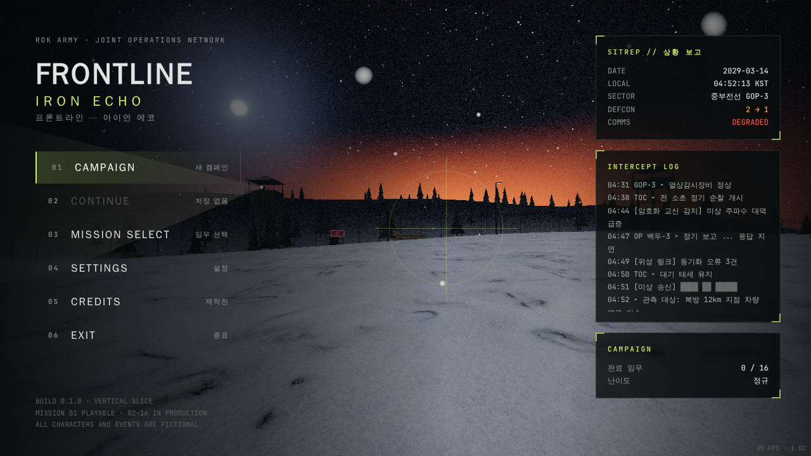 | 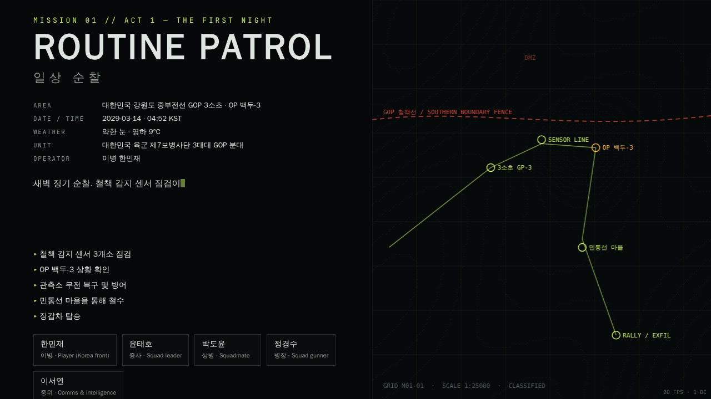 |
| 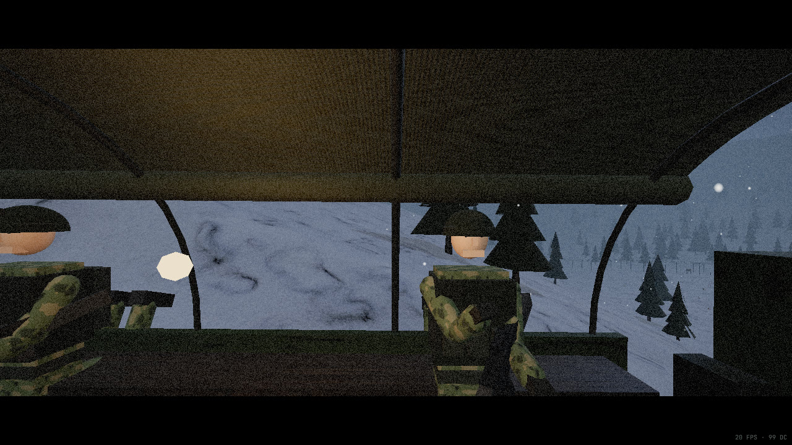 | 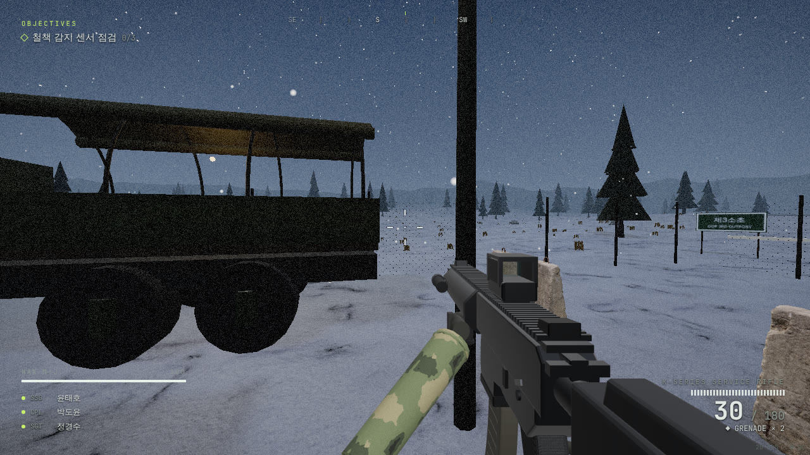 |
| 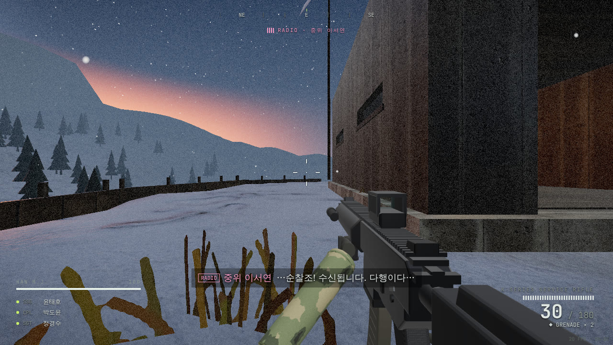 | 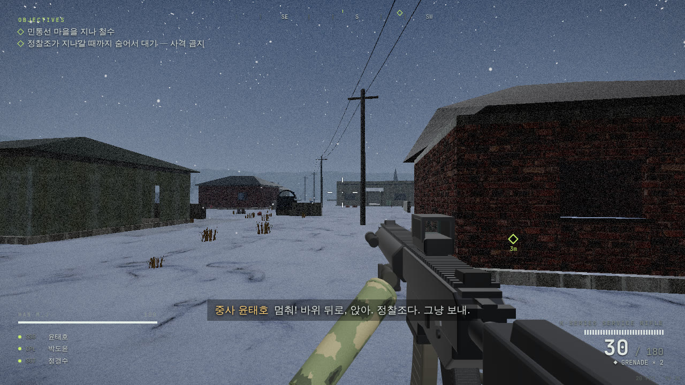 |
| 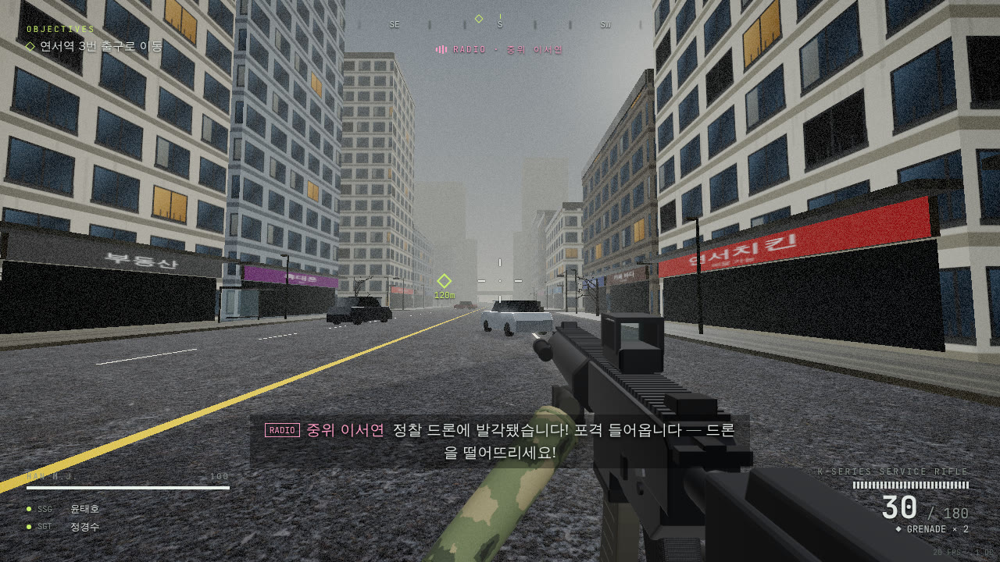 | 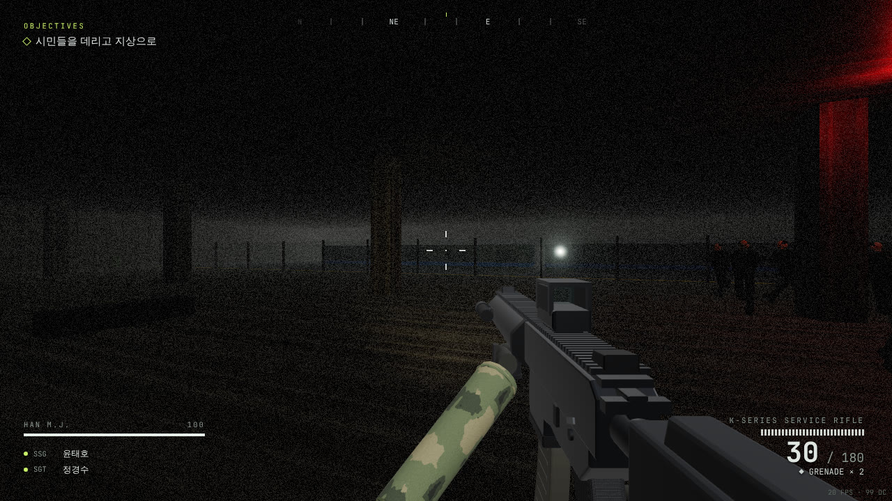 |
| 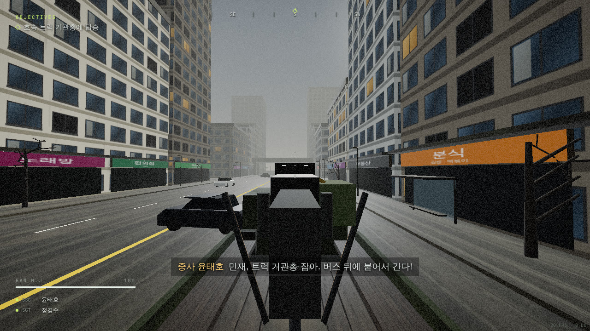 | 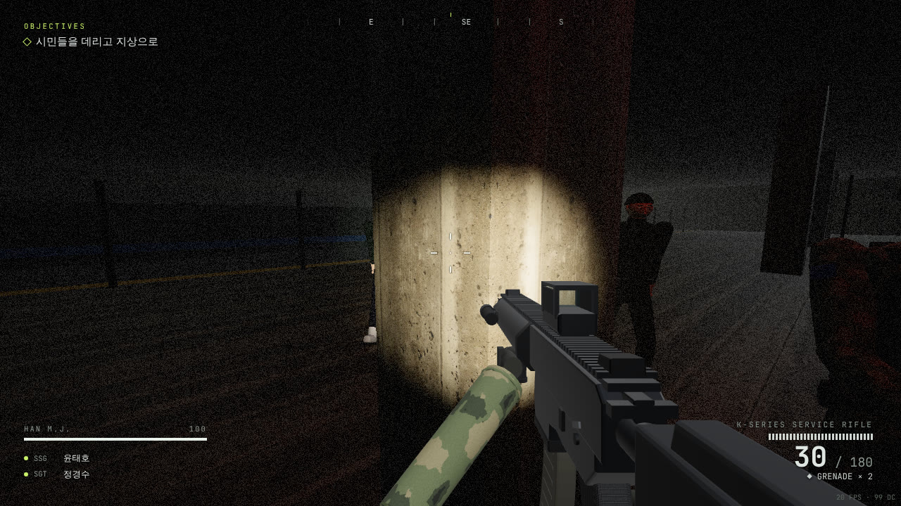 |
| 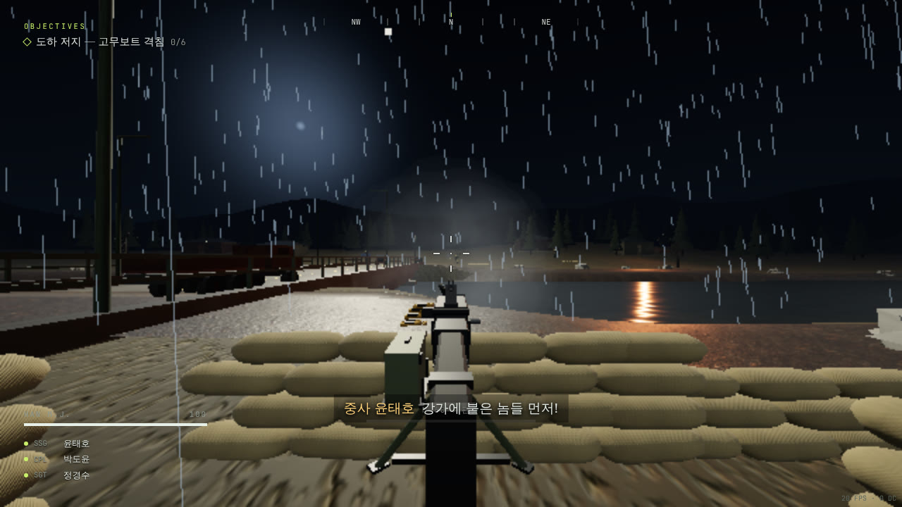 | 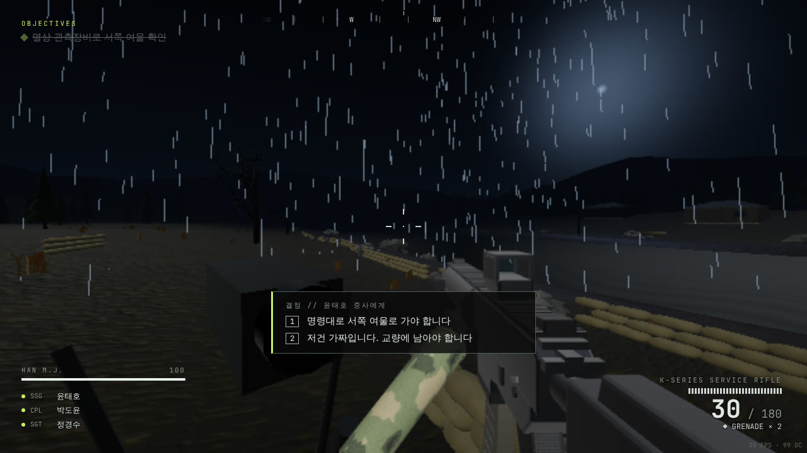 |
| 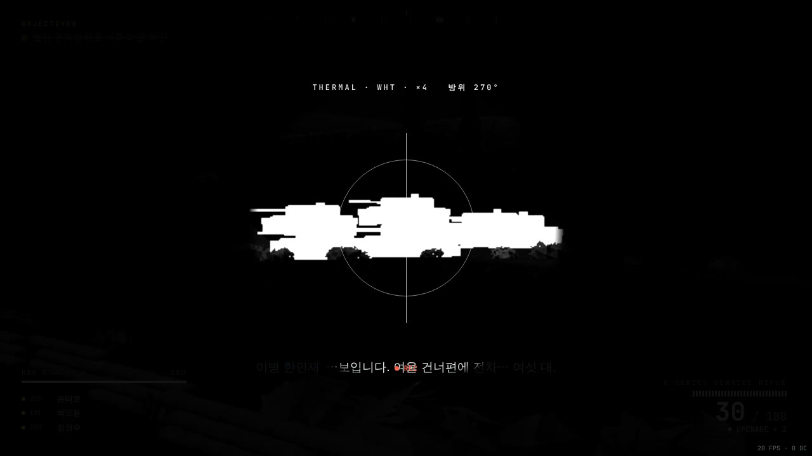 | 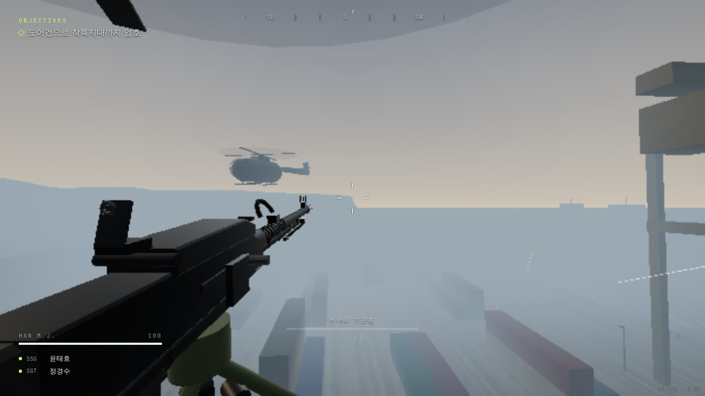 |
| 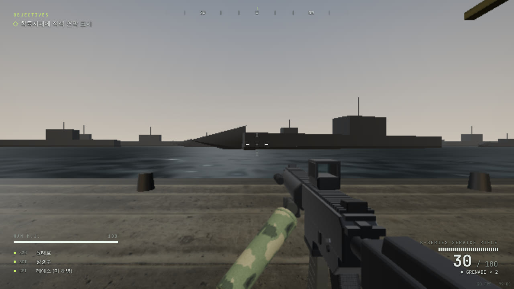 | |

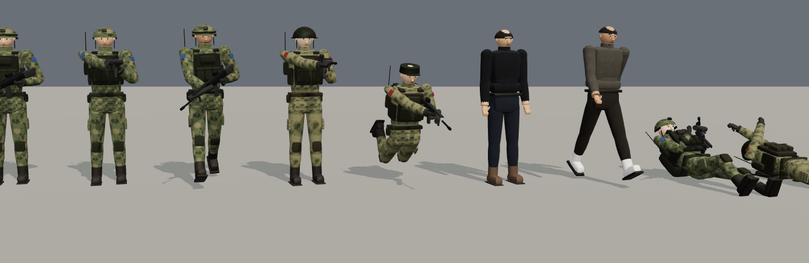

(헤드리스 소프트웨어 렌더링으로 캡처했습니다. GPU 브라우저에서는 더 선명하고 부드럽게 보입니다. 스크린샷은 M01–M04 시점 것이며 M05–M07·서울 대도시 스크린샷은 아직 추가하지 않았습니다.)

## 실행

필요: Node.js 18+ (개발), GPU 가속이 켜진 최신 Chrome / Edge / Firefox (플레이).

```bash
npm install
```

```bash
npm run dev
```

브라우저에서 표시된 주소(기본 http://localhost:5173)를 엽니다. 배포용 빌드:

```bash
npm run build
```

```bash
npm run preview
```

### 웹에서 바로 플레이 (GitHub Pages)

https://oblocko.github.io/FRONTLINE-IRONECHO/ — 빌드 없이 원본 소스를 그대로 제공합니다. `index.html`의 import map이 `vendor/three`(three.js r187, MIT)를 가리킵니다. three.js 버전을 올리면 `vendor/three`도 함께 갱신해야 합니다(`tools/check_vendor.mjs`로 확인).

푸시 후 사이트 반영에 1–2분 걸리고, 브라우저가 파일을 약 10분간 캐시합니다. 새 버전이 안 보이면 강력 새로고침(Ctrl+Shift+R)을 한 뒤 메인 메뉴 하단의 버전·빌드 시각을 확인하세요.

### 성능 확인 (실제 GPU)

게임 주소 뒤에 `?bench`를 붙여 열면(예: `https://oblocko.github.io/FRONTLINE-IRONECHO/?bench`) M01–M05의 무거운 장면 10곳을 차례로 불러와 장면마다 10초씩 측정합니다(`?bench=quick`은 4초). 끝나면 평균 FPS, 하위 1% FPS, 가장 긴 프레임, 드로우콜, 삼각형 수, GPU 이름, 현재 그래픽 설정이 표와 JSON으로 나옵니다. 자동 테스트는 소프트웨어 렌더링(SwiftShader)이라 실제 GPU 프레임은 이 벤치마크로 확인해야 합니다.

### 음성

녹음된 성우 음성은 없습니다. 설정 → 오디오 → "대사 음성: 음성 합성"이면 운영체제에 설치된 한국어 음성(Windows: Microsoft Heami 등, macOS: Yuna)으로 대사를 읽습니다. 한국어 음성이 없으면 합성 웅얼거림으로 대체됩니다.

## 조작 (기본값, 설정에서 변경 가능)

| 동작 | 키보드/마우스 | 게임패드 |
|---|---|---|
| 이동 / 시점 | WASD / 마우스 | 왼쪽 / 오른쪽 스틱 |
| 달리기 · 앉기 · 점프(장애물 넘기) | Shift · C · Space | L3 · B · A |
| 조준 · 사격 | 우클릭 · 좌클릭 | LT · RT |
| 재장전 / 상호작용 (길게 누르기 지원) | R / F | X |
| 수류탄 · 무기 교체 | G · 1, 2, 휠 | RB · Y |
| 쌍안경(화력 지원) · 손전등 | B · L | — |
| 일시정지 | Esc (또는 P) | Start |

## 테스트

```bash
npm test
```

헤드리스 Chromium(SwiftShader)으로 부팅 → 메인 메뉴 → 설정 → 임무 선택 → 브리핑 → Mission 01 출격까지 확인합니다.

```bash
npm run test:mission
```

Mission 01 전체를 자동으로 진행(트럭 → 센서 → OP 교전 → 무전 → 방어 → 마을 → 장갑차 → 완료 화면 → 저장 확인)합니다. 소프트웨어 렌더링이라 약 30분 걸립니다. 스크린샷은 `tests/output/`.

디버그 URL 옵션: `?nolock` (포인터 락 없이 실행), `?autostart` (클릭 대기 생략).

## 문서

- [docs/STORY_BIBLE.md](docs/STORY_BIBLE.md) — 세계관, 인물, 주제
- [docs/CAMPAIGN.md](docs/CAMPAIGN.md) — 16개 미션 상세 시나리오
- [docs/LEVELS.md](docs/LEVELS.md) — 레벨/캐릭터 배치 계획
- [docs/ARCHITECTURE.md](docs/ARCHITECTURE.md) — 시스템 구조

모든 인물·부대·사건은 허구입니다. 게임 내 장비와 전투는 게임용으로 추상화되어 있으며 비고어 방식으로 표현됩니다.
